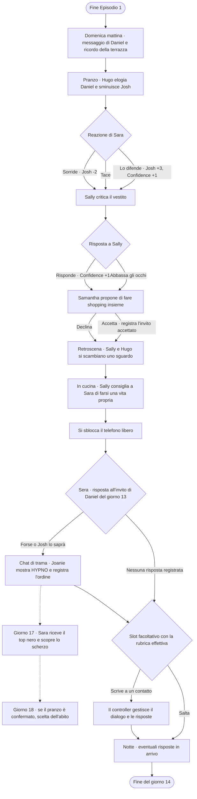
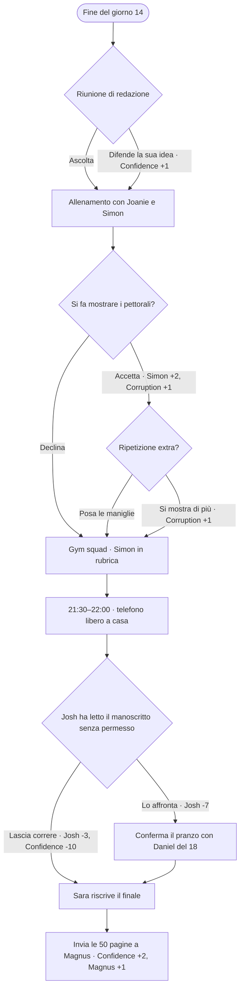
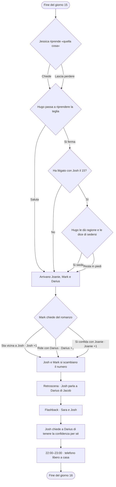
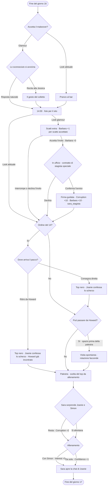
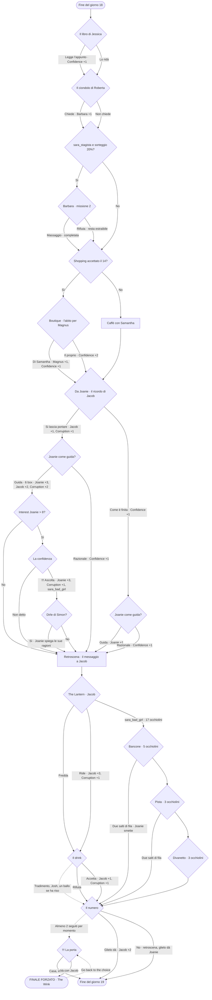
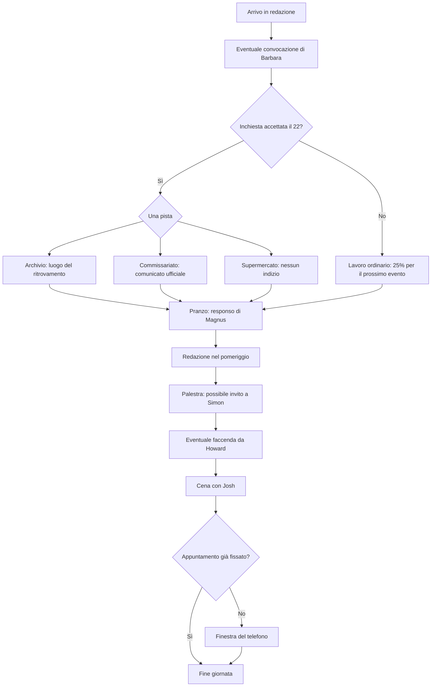

# The Thin Line — Grafo del gioco

Aggiornato al 17 novembre 2026 (giorni 1-2 riscritti in inglese; il resto dopo il lotto A1-A10) · Episodio 1 (versione 0.1.0-dev). Si aggiorna a ogni lotto di decisioni applicato ([regole](regole-di-lavoro.md), punto 2).

**Legenda**
- Rettangolo: scena · Rombo: bivio del giocatore · Esagono: retroscena (il giocatore lo vede, Sara no) · Rettangolo tratteggiato: scena condizionata
- Colori: 🟩 Simon · 🟪 Daniel · 🟫 Howard · 🟨 editore · 🟦 trama principale con Josh · 🟥 segreti e retroscena
- `Simon+5` = Interest verso Simon · `Josh+3` = Interest verso Josh · `Corr` = Corruption · `Conf` = Confidence · `Susp` = Suspicion · 🔒 = frase con requisito (A3) · `P` = bivio provvisorio

## Episodio 1

```mermaid
flowchart TD
    classDef main fill:#1f3a5f,stroke:#8fb3e0,color:#fff
    classDef simon fill:#1f4d3a,stroke:#7fd1a8,color:#fff
    classDef daniel fill:#3d2a5c,stroke:#c9a0ff,color:#fff
    classDef howard fill:#4a3f2c,stroke:#b5a48a,color:#fff
    classDef editore fill:#5a4a24,stroke:#d4b483,color:#fff
    classDef retro fill:#5c1f2e,stroke:#ff9fb0,color:#fff
    classDef scelta fill:#2a2a2a,stroke:#ffffff,color:#fff
    classDef cond fill:#1f4d3a,stroke:#7fd1a8,color:#fff,stroke-dasharray:5 5

    START([Avviso 18+ · nome di Josh]):::main

    subgraph G1 [Giorno 1 · Lunedì · riscritto in inglese]
        A1[Mattina: l'armadio e lo specchio]:::main
        A1C{Un bottone aperto? sì: Conf+1}:::scelta
        R1[Redazione: Barbara, Roberta, Jessica · I21 I22]:::main
        R1C{Rimprovero di Barbara<br/>spiegare: Conf+1 · battuta: Conf+1 Barbara+1}:::scelta
        R1S{Commento sulla scollatura<br/>«Grazie... credo»: Barbara+1}:::scelta
        R1J{★ Aperitivo di giovedì con le colleghe?}:::scelta
        P1[Prologo a casa: Sara scrive, arriva Josh]:::main
        P1C{★ Serata con Josh 🔒Josh 30: Josh+3<br/>o scrivere: Conf+2}:::scelta
        P1D{Cena: risotto Josh+1 · pizza}:::scelta
        P1T[Joanie la iscrive in palestra]:::main
        P1TC{Entusiasta: Joanie+1 · sbuffando}:::scelta
    end

    subgraph G2 [Giorno 2 · Martedì · riscritto in inglese]
        R2[Redazione: giornata normale]:::main
        R2C{Pausa pranzo<br/>colleghe · scrivere: Conf+1 · messaggi a Josh: Josh+1}:::scelta
        S0{Cosa indossare<br/>maglietta larga · top di Joanie: Conf+1 Corr+1}:::scelta
        S1[Simon 1 · prima visita con Joanie]:::simon
        S1C{È bello?}:::scelta
        S1S{Simon la saluta<br/>sorridere: Simon+1 · cenno}:::scelta
        S2[Simon 2 · Joanie flirta mentre lui la corregge]:::simon
        S2C{Guardare o no?<br/>guardare: Corr+1}:::scelta
        INV[Josh: invito alla cena aziendale di domani]:::main
        INVC{Entusiasta: Josh+1 · preoccupata per Daniel}:::scelta
    end

    subgraph G3 [Giorno 3 · La cena aziendale]
        D1[Daniel 1 · cena aziendale]:::daniel
        D1R{{Daniel guarda Sara}}:::retro
        D1C{Reazione alle battute P<br/>a tono: Daniel+2 · mano a Josh: Josh+2}:::scelta
        D1A{In auto P<br/>consolare: Josh+3 · perché? Josh-2}:::scelta
    end

    subgraph G4 [Giorno 4 · Una mattina di corsa]
        H1[Howard 1 · pianerottolo]:::howard
        H1C{Fermarsi? P<br/>sì: Howard+2}:::scelta
        D2[Daniel 2 · la patente in ufficio]:::daniel
    end

    subgraph G5 [Giorno 5 · Sabato]
        H2[Howard 2 · la spesa]:::howard
        H2R{{Furto: biancheria + chiavi}}:::retro
        S3[Simon 3 · al locale con Joanie e Josh · Simon+2]:::simon
    end

    subgraph G6 [Giorno 6 · Da sola]
        S4[Simon 4 · Joanie dà buca]:::simon
        S4C{Entrare o tornare a casa?}:::scelta
        S5[Simon 5 · allenamento con Simon<br/>Simon+3/+5 · 🔒Corr 15: Simon+6 Corr+3]:::cond
        CASA6[A casa con Josh · Josh+1]:::main
    end

    subgraph G7 [Giorno 7 · Chiusa fuori]
        H3R{{Howard sa che Josh fa il turno lungo}}:::retro
        H3[Howard 3 · senza chiavi, ospite da Howard]:::howard
        H3P{{Il pianto è finto}}:::retro
        H3C{Vederci più spesso? P<br/>sì: +5 · forse: +2 · no: 0, percorso aperto}:::scelta
    end

    subgraph G8 [Giorno 8 · La festa]
        D3R{{Daniel ha organizzato l'incontro}}:::retro
        D3[Daniel 3 · festa in villa]:::daniel
        ED[L'editore · primo incontro]:::editore
        EDC{Entusiasmo o timidezza? P<br/>editore +4/+2 · 🔒Conf 25: editore+5 Conf+2}:::scelta
        FIN[Finale a casa]:::main
        FINC{Dire a Josh dell'editore? P}:::scelta
        SEG[/Segreto: biglietto dell'editore · Corr+2 Susp+3/]:::retro
        FINR{{Messaggio dell'editore a Daniel}}:::retro
    end

    START --> A1 --> A1C --> R1 --> R1C --> R1S --> R1J --> P1 --> P1C --> P1D --> P1T --> P1TC
    P1TC --> R2 --> R2C --> S0 --> S1 --> S1C --> S1S --> S2 --> S2C --> INV --> INVC --> D1
    D1 --> D1R --> D1C --> D1A --> H1 --> H1C --> D2 --> H2 --> H2R --> S3 --> S4 --> S4C
    S4C -- entra: Conf+3 --> S5 --> H3R
    S4C -- torna --> CASA6 --> H3R
    H3R --> H3 --> H3P --> H3C --> D3R --> D3 --> ED --> EDC --> FIN --> FINC
    FINC -- lo dice 🔒Josh 30: Josh+2 --> FINR
    FINC -- lo tiene per sé --> SEG --> FINR
    FINR --> FINE([Fine Episodio 1])

    %% Collegamenti tra percorsi
    H2R -. le chiavi servono il giorno 7 .-> H3
    D3 -. Daniel presenta un potenziale rivale .-> ED
    S5 -. se taciuto, Sara ci ripensa nel finale .-> FIN
    S2 -. Joanie · percorso 5, molto più avanti .-> S2C
```

## Stato a fine Episodio 1

| Percorso | Tappa massima | Interest massimo | Soglia Corruption | Note |
|---|---|---|---|---|
| Simon | 2 | 8 | 15 | Tappa 2 solo con la scena 5 (se Sara entra in palestra); la frase 🔒 resta chiusa nell'Episodio 1 |
| Daniel | 2 | 2 | 45 | Sara lo vede ancora come arrogante, ma qualcosa si incrina alla festa |
| Howard | 2 | 8 | 75 | Il rifiuto non chiude il percorso |
| Editore | 1 | 5 | 65 | Nasce dal percorso di Daniel; +5 solo con Confidence 25 |
| Joanie | 0 | 0 | 55 | Percorso 5, non ancora aperto |
| Ex, amico di Josh, capa | — | — | 25 · 35 · 85 | Non ancora presenti |

| Sara | Valore massimo nell'Episodio 1 |
|---|---|
| Corruption | 3 (guardare Joanie con Simon, tenere il segreto) |
| Confidence | 27 (parte da 20: scrivere, entrare da sola, coraggio con l'editore) |
| Suspicion | 3 (il segreto dell'editore) |
| Interest verso Josh | parte da 80, finisce tra 78 e 91 |

## Episodio 2 · Giorno 14

## Episodio 2 · Giorno 15

## Episodio 2 · Giorno 16

## Episodio 2 · Giorno 17

## Episodio 2 · Giorno 19

## Episodio 2 · Giorno 23

