# The Thin Line — Grafo del gioco

Aggiornato al 16 novembre 2026 · Episodio 1 (versione 0.1.0-dev). Si aggiorna a ogni lotto di decisioni applicato ([regole](regole-di-lavoro.md), punto 2).

**Legenda**
- Rettangolo: scena · Rombo: bivio del giocatore · Esagono: retroscena (il giocatore lo vede, Sara no) · Rettangolo tratteggiato: scena condizionata
- Colori: 🟩 Simon · 🟪 Daniel · 🟫 Howard · 🟨 editore · 🟦 trama principale con Josh · 🟥 segreti e retroscena
- `+n` = affinità del percorso · `L` = legame con Josh · `C` = curiosità di Sara · `P` = bivio provvisorio

## Episodio 1

```mermaid
flowchart TD
    classDef main fill:#1f3a5f,stroke:#8fb3e0,color:#fff
    classDef simon fill:#1f4d3a,stroke:#7fd1a8,color:#fff
    classDef daniel fill:#3d2a5c,stroke:#c9a0ff,color:#fff
    classDef howard fill:#4a3f2c,stroke:#b5a48a,color:#fff
    classDef editore fill:#5a4a24,stroke:#d4b483,color:#fff
    classDef retro fill:#5c1f2e,stroke:#ff9fb0,color:#fff
    classDef scelta fill:#2a2a2a,stroke:#ffffff,color:#fff
    classDef cond fill:#1f4d3a,stroke:#7fd1a8,color:#fff,stroke-dasharray:5 5

    START([Avviso 18+ · nome di Josh]):::main

    subgraph G1 [Giorno 1 · Una vita normale]
        P1[Prologo a casa: Sara scrive, arriva Josh]:::main
        P1C{Serata con Josh<br/>o scrivere? P}:::scelta
        P1T[Joanie la iscrive in palestra]:::main
    end

    subgraph G2 [Giorno 2 · Primo giorno di palestra]
        S1[Simon 1 · prima visita con Joanie]:::simon
        S1C{È bello? P}:::scelta
        S2[Simon 2 · Joanie flirta mentre lui la corregge]:::simon
        S2C{Guardare o no? P<br/>guardare: C+2}:::scelta
        INV[Josh: invito alla cena aziendale]:::main
    end

    subgraph G3 [Giorno 3 · La cena aziendale]
        D1[Daniel 1 · cena aziendale]:::daniel
        D1R{{Daniel guarda Sara}}:::retro
        D1C{Reazione alle battute P<br/>a tono: Daniel+2 · mano a Josh: L+2}:::scelta
        D1A{In auto P<br/>consolare: L+3 · perché? L-2 C+1}:::scelta
    end

    subgraph G4 [Giorno 4 · Una mattina di corsa]
        H1[Howard 1 · pianerottolo]:::howard
        H1C{Fermarsi? P<br/>sì: Howard+2}:::scelta
        D2[Daniel 2 · la patente in ufficio]:::daniel
    end

    subgraph G5 [Giorno 5 · Sabato]
        H2[Howard 2 · la spesa]:::howard
        H2R{{Furto: biancheria + chiavi}}:::retro
        S3[Simon 3 · al locale con Joanie e Josh · Simon+2]:::simon
    end

    subgraph G6 [Giorno 6 · Da sola]
        S4[Simon 4 · Joanie dà buca]:::simon
        S4C{Entrare o tornare a casa?}:::scelta
        S5[Simon 5 · allenamento con Simon<br/>Simon+3/+5]:::cond
        CASA6[A casa con Josh · L+1]:::main
    end

    subgraph G7 [Giorno 7 · Chiusa fuori]
        H3R{{Howard sa che Josh fa il turno lungo}}:::retro
        H3[Howard 3 · senza chiavi, ospite da Howard]:::howard
        H3P{{Il pianto è finto}}:::retro
        H3C{Vederci più spesso? P<br/>sì: +5 · forse: +2 · no: 0, percorso aperto}:::scelta
    end

    subgraph G8 [Giorno 8 · La festa]
        D3R{{Daniel ha organizzato l'incontro}}:::retro
        D3[Daniel 3 · festa in villa]:::daniel
        ED[L'editore · primo incontro]:::editore
        EDC{Entusiasmo o timidezza? P<br/>editore +4/+2}:::scelta
        FIN[Finale a casa]:::main
        FINC{Dire a Josh dell'editore? P}:::scelta
        SEG[/Segreto: biglietto dell'editore · C+2/]:::retro
        FINR{{Messaggio dell'editore a Daniel}}:::retro
    end

    START --> P1 --> P1C --> P1T --> S1 --> S1C --> S2 --> S2C --> INV --> D1
    D1 --> D1R --> D1C --> D1A --> H1 --> H1C --> D2 --> H2 --> H2R --> S3 --> S4 --> S4C
    S4C -- entra --> S5 --> H3R
    S4C -- torna --> CASA6 --> H3R
    H3R --> H3 --> H3P --> H3C --> D3R --> D3 --> ED --> EDC --> FIN --> FINC
    FINC -- lo dice: L+2 --> FINR
    FINC -- lo tiene per sé --> SEG --> FINR
    FINR --> FINE([Fine Episodio 1])

    %% Collegamenti tra percorsi
    H2R -. le chiavi servono il giorno 7 .-> H3
    D3 -. Daniel presenta un potenziale rivale .-> ED
    S5 -. se taciuto, Sara ci ripensa nel finale .-> FIN
    S2 -. Joanie · percorso 5, molto più avanti .-> S2C
```

## Stato dei percorsi a fine Episodio 1

| Percorso | Tappa massima | Affinità massima | Note |
|---|---|---|---|
| Simon | 2 | 7 | Tappa 2 e +5 solo con la scena 5 (se Sara entra in palestra) |
| Daniel | 2 | 2 | Sara lo vede ancora come arrogante, ma qualcosa si incrina alla festa |
| Howard | 2 | 8 | Il rifiuto non chiude il percorso |
| Editore | 1 | 4 | Nasce dal percorso di Daniel |
| Joanie | 0 | 0 | Percorso 5, non ancora aperto |
| Ex, amico di Josh, capa | — | — | Non ancora presenti |
